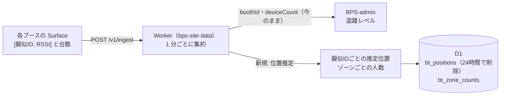

# BLE 位置推定 設計案（bps-site-data 向け）

> サーバー側（Shoki さん担当の `bps-site-data`・`bps-site-admin`・`bps-site-viewer`）への変更提案です。このリポジトリでは実装しません。センサー側の送信形式は PR #30 の `devices: [[擬似ID, RSSI], ...]` を前提にしています。
>
> 2026-11-27 作成

## 概要

Surface が送る `[擬似ID, RSSI]` を Worker の1分ごとの集約で突き合わせ、擬似IDごとに「どのブースの近くにいたか」を推定します。D1 に保存するのは、ゾーンごとの人数と、擬似IDごとの推定位置（24時間以内に削除）です。精度は「どのブースの近くか」程度で、メートル単位の座標は目安にとどまります。

- **前提:** Surface 側は PR #30（`C0uki/bluetooth-positioning-system`）で `devices: [[擬似ID, RSSI], ...]` を送るよう変更済みです（未マージ）。
- **未確認の点:** Worker（`bps-site-data`）のコードは読めていません。この案はサーバー側の設計ドキュメントに基づきます。1分ごとの集約の仕組み（Durable Object・KV など）は、今の Worker の実装に合わせてください。
- **変えないもの:** 混雑レベルの算出、admin への一括送信、フェイルオーバーは今のままです。



台数の流れは今のままで、Worker の 1 分ごとの集約に位置推定と D1 への書き込みを足します。

## 受信 API の変更（`POST /v1/ingest`）

リクエストに `devices` などを足すだけで、レスポンスと認証は変えません。`devices` がないリクエストは今までどおり台数だけとして扱います。

| フィールド | 型 | 必須 | 検証 | 内容 |
| --- | --- | --- | --- | --- |
| `devices` | `[string, number][]` | — | 1000件以下。ID は `^[0-9a-f]{16}$`、RSSI は -120〜0 の整数。違反は 400 `invalid devices` | `[擬似ID, RSSI]`（RSSI の強い順） |
| `devicesTruncated` | boolean | — | 省略時 false | 16KB に収めるため強い順に一部だけ送ったとき true |
| `scannedAt` | string（ISO 8601） | — | 受信時刻から 5 分以上ずれていたら受信時刻を使う | スキャンを終えた時刻。Surface 側に追加予定 |

- `deviceCount` は常に全台数で、`devices` の件数と一致しないことがあります（`devicesTruncated` のとき）。
- 旧バージョンの `macAddresses` と `{pseudoId, rssi}` 形式の `devices` は無視します。
- Worker は `devices` を admin に転送せず、自分で位置推定に使います。admin への一括送信は今までどおり `boothId` と `deviceCount` だけです。

## RSSI から距離帯への変換とキャリブレーション

距離は対数距離パスロスモデルで出し、「近・中・遠」の3帯として使います。スマホの機種による送信出力の差が 10dB 前後あるため、メートルの値そのものは信用しません。

```math
d = 10^{\frac{P_{1m} - \mathrm{RSSI}}{10\,n}}
```

P1m は 1m の距離での RSSI、n は減衰係数（屋内で 2〜3）です。未設定のブースは P1m = -59、n = 2.5 を使います。

| 帯 | 推定距離 | 使い方 |
| --- | --- | --- |
| 近 | 2m 未満 | そのブースの中・目の前とみなす |
| 中 | 2〜5m | ブースの周り。位置推定の重みに使う |
| 遠 | 5m 以上 | 位置推定には使うが、そのブースの人数には数えない |

### ブースごとのキャリブレーション（朝の事前テスト）

1. 各 Surface の位置をフロアマップ上の座標（m）と階で記録する。
2. 基準のスマホ（iPhone と Android を各 1 台）を Surface から 1m に 30 秒置き、RSSI の中央値を P1m とする。
3. 同じスマホを 4m に 30 秒置き、中央値 R4m から n = (P1m − R4m) ÷ (10 × log10(4)) を求める。
4. 値を admin のブース編集画面で `booths` に入れる（追加フィールドは「保存するデータ」の節）。

RSSI の計測には、Surface のローカル CSV（`logs/rssi_log_*.csv`）を使えます。以前の `RSSI_THRESHOLD` を決める朝のテストと同じ時間にできます。

## 複数ブースでの位置推定

まずは「重み付き重心」だけで始め、三点測位（最小二乗法）は後から足すのが安全です。壁や人の体で RSSI が大きく変わるため、三点測位は教室の中でも解が大きくずれやすいからです。

Worker は 1 分ごとの集約（admin への一括送信と同じタイミング）で、擬似IDごとに次の順で推定します。

1. その1分間に各ブースが聞いた RSSI を集める。同じブースが複数回聞いたら最大値を使う。
2. RSSI が一番強いブースの階をその端末の階とし、他の階のブースは捨てる。
3. 各ブースのキャリブレーション値で距離 d を出し、10m より遠いブースは捨てる。
4. 残りが 1 ブースなら、位置はその Surface の座標、確度は「低」。
5. 2 ブース以上なら、Surface の座標を 1/d² で重み付けした平均を位置とする。3 ブース以上なら確度「中」。
6. 推定位置に一番近い Surface のブースをその端末の「ゾーン」とし、ゾーンごとに人数を数える。

```math
(x, y) = \frac{\sum_i w_i\,(x_i, y_i)}{\sum_i w_i}, \quad w_i = \frac{1}{d_i^{2}}
```

出力は擬似IDごとに `階・x・y（m）・ゾーン・聞いたブース数・確度` です。各 Surface のスキャンはそれぞれ 60 秒に 10 秒で、時刻もそろっていないため、窓は 1 分より短くしないでください。

## 保存するデータ・保存期間・削除

ブースごとの生の RSSI は保存せず、推定結果だけを D1 に入れます。擬似IDを含む表は 24 時間以内に消し、残すのはゾーンごとの人数だけです。

| 保存先 | 中身 | 擬似ID | 保存期間 |
| --- | --- | --- | --- |
| `bt_positions`（新しい表） | 1 分ごと・擬似IDごとの階・x・y・ゾーン・聞いたブース数・確度 | あり | 24 時間以内（毎日の cron で削除） |
| `bt_zone_counts`（新しい表） | 1 分ごと・ゾーンごとの人数 | なし | 台数の集計データと同じ（運営の判断） |
| `booths`（既存、フィールド追加） | `sensorX`・`sensorY`（m）・`floor`・`rssiAt1m`・`pathLossN` | なし | 今までどおり |
| Surface のローカル CSV（既存） | 擬似ID・RSSI の全件 | あり | 遅くとも 2027-03-31 まで（今のポリシーどおり） |

```sql
CREATE TABLE bt_positions (
  minute TEXT NOT NULL,        -- '2027-09-07T10:15'
  pseudo_id TEXT NOT NULL,
  floor INTEGER NOT NULL,
  x REAL NOT NULL,
  y REAL NOT NULL,
  zone TEXT NOT NULL,          -- boothId
  booths_heard INTEGER NOT NULL,
  confidence TEXT NOT NULL,    -- 'low' | 'mid'
  PRIMARY KEY (minute, pseudo_id)
);
CREATE TABLE bt_zone_counts (
  minute TEXT NOT NULL,
  zone TEXT NOT NULL,
  count INTEGER NOT NULL,
  PRIMARY KEY (minute, zone)
);
```

- 表の作成は今のマイグレーションの流れどおりに足します。
- `bt_positions` は 1 分ごとに検知台数分の行が増えます（例: 1500 台 × 480 分で 1 日 72 万行）。D1 の書き込み上限に届く場合は、5 分ごとに間引くか、`bt_zone_counts` だけにします。契約中のプランの上限は要確認です。
- より安全にするなら、Surface 側でソルトに日付を混ぜ（`hash(salt:日付:MAC)`）、日をまたいで同じ端末を結び付けられないようにします。

## 精度の限界

一番大きいのは BLE アドレスの変化で、同じ人を長く追うことはできません。この設計は「1 分ごとに人がどこに何人いるか」を出すもので、動線の分析には使えません。

| 限界 | 起きること | 対策 |
| --- | --- | --- |
| BLE アドレスが数分〜十数分ごとに変わる（iOS・Android のプライバシー機能） | 同じ人が別の擬似IDになり、追跡が途切れる | 1 分ごとの分布だけを出す。異なる擬似IDを同じ人としてつながない |
| 待機中のスマホは広告が少ない、または出さない | 数え漏れが出る | 人数は「相対値」として扱い、`baselineMax` との比で見る |
| 1 人が複数台（ウォッチ・イヤホン）を持つ | 人数が多めに出る | 同上 |
| 壁・人の体・機種による出力差（±10dB 前後） | 距離が 2 倍以上ずれることがある | 距離帯で扱い、座標はゾーンに丸めて表示する |
| Surface のスキャンが 60 秒に 10 秒で、時刻もそろわない | 同じ端末を全ブースが同じ窓で聞くとは限らない | 窓は 1 分、`scannedAt` で窓に振り分ける |
| 混雑時は `devicesTruncated`（約 600 台超） | 遠い端末がそのブースのデータから落ちる | 近い端末は残るので、ゾーン人数への影響は小さい |

## プライバシーポリシーと会場掲示の変更案

今のポリシーは「サーバーは台数だけを保存する」「特定個人の行動追跡には使わない」と書いているため、位置推定を始める前に次の 5 か所をそろえて直す必要があります。公開前に、先生など責任者の確認を取るのが安全です（センサー側のポリシーも、法的整理は専門家に確認するよう書いています）。

| 直す場所 | 今 | 変更案 |
| --- | --- | --- |
| `bluetooth-positioning-system/docs/privacy.md` 第1条（目的） | 混雑表示と精度の検証のみ。行動追跡には使わない | 目的に「会場内の人の分布（ブース単位）の把握」を足す。「擬似IDを個人と結び付けたり、時間をまたいで移動を追ったりはしない」と書き換える |
| 同 第2条 2.3（保存・送信するデータ） | 擬似ID・RSSI は端末内のみ | 「擬似IDごとの推定位置（1分単位）」「ゾーンごとの人数」をサーバー（D1）に保存する行を足す。ブースごとの生の RSSI はサーバーに保存しない |
| 同 第4条（保持期間） | サーバーは台数のみ | 「擬似IDごとの推定位置は 24 時間以内に削除」を足す |
| 同 第7条、サーバー側のプライバシー・セキュリティの文書 | 擬似ID・RSSI はサーバーにない | 推定位置は管理画面の権限を持つ運営者だけが見られ、来場者向けにはゾーンの人数・混雑レベルだけを出すと書く |
| 閲覧アプリ `/legal/privacy` §5・§8 | 台数のみ保存 | 上と同じ内容にそろえる |

### 会場掲示の変更案

今の掲示文に、おおよその場所を推定することと、その削除の期限を書き足します。

```
【混雑状況の計測について】

本会場では、混雑状況の把握のため、スマートフォン等が発信する
Bluetooth信号を検知し、台数とおおよその場所（どのブースの近くか）を
推定しています。

・検知した識別子はその場で匿名化（暗号学的ハッシュ化）され、
  氏名など個人を特定できる情報は取得しません。
・匿名化した識別子ごとの推定場所は、24時間以内に削除します。
・通信内容の傍受は行いません。
・公開するのは場所ごとの混雑状況だけで、第三者には提供しません。
・計測を希望されない場合は、端末のBluetoothをオフにしてください。

お問い合わせ: BPSプロジェクト
```

## 作業の分担と決定待ちの点

Surface 側は Couki、Worker・admin・閲覧アプリ側は Shoki が担当します。ポリシーと掲示は二人でそろえます。

**Couki（`bluetooth-positioning-system`）**

- [ ] PR #30 をマージし、`devices` を短い形で送る
- [ ] 送信データに `scannedAt` を足す
- [ ] ソルトに日付を混ぜるか決め、混ぜるなら実装する
- [ ] 各 Surface の座標と階を測り、朝のキャリブレーション手順を `docs/` に書く

**Shoki（`bps-site-data`・`bps-site-admin`・`bps-site-viewer`）**

- [ ] `/v1/ingest` で `devices`・`devicesTruncated`・`scannedAt` を検証して受け取る
- [ ] 1 分ごとの集約で位置を推定し、`bt_positions`・`bt_zone_counts` に書く
- [ ] D1 のマイグレーションと `booths` の追加フィールド、admin の編集画面
- [ ] `bt_positions` を 24 時間ごとに消す cron
- [ ] ゾーンの人数を地図に出す画面（admin、必要なら viewer）

**二人で**

- [ ] プライバシーポリシー 5 か所と会場掲示を直し、責任者の確認を取る

### 決定待ち

- 擬似IDごとの推定位置を保存するか。保存せず `bt_zone_counts` だけにすれば、ポリシーの変更は小さくて済みます。
- ゾーンの人数を来場者向けにも出すか、管理画面だけにするか。
- D1 の書き込み量がプランの上限に収まるか。
